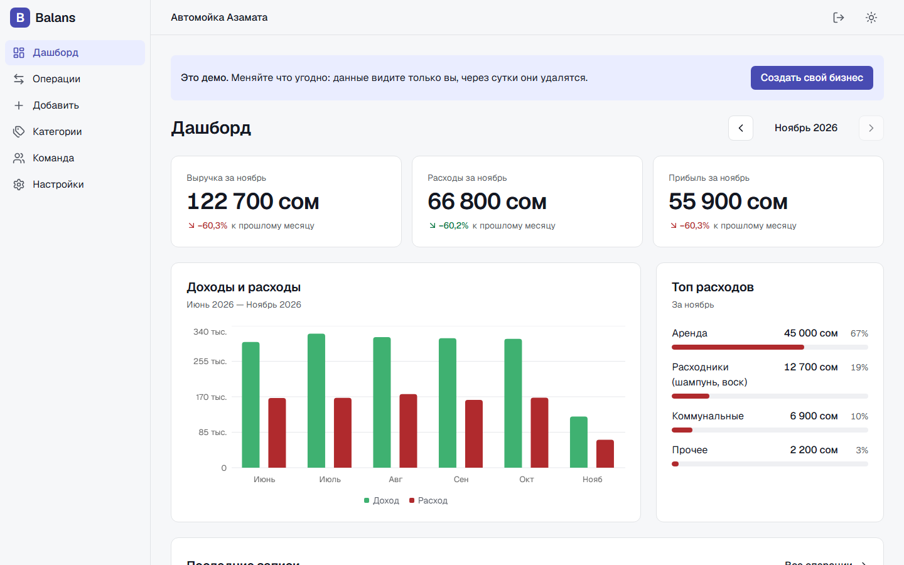
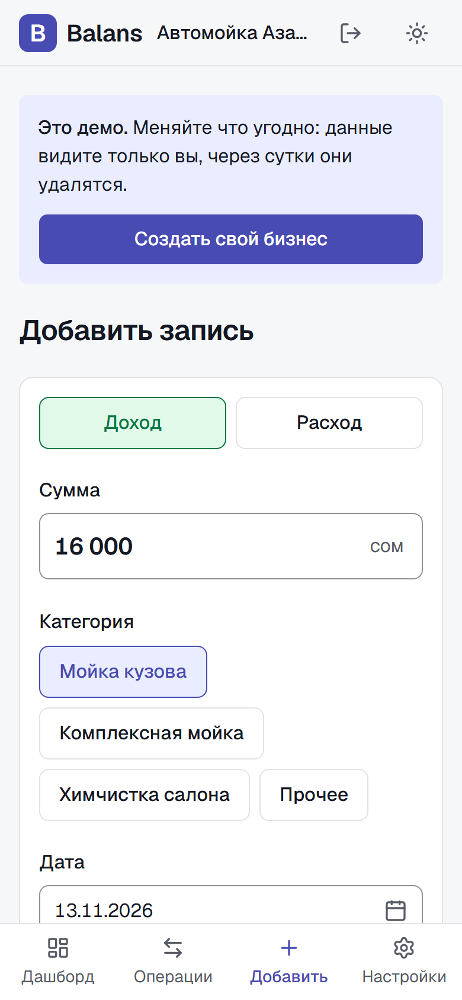
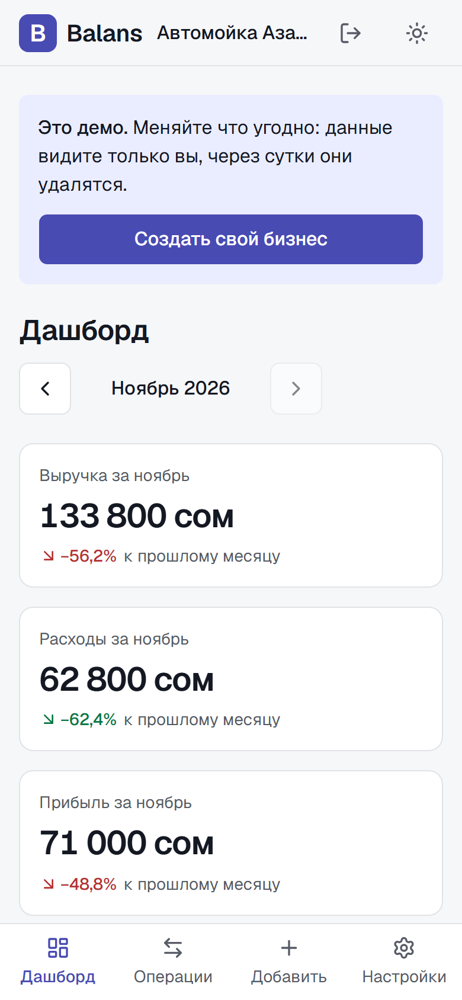
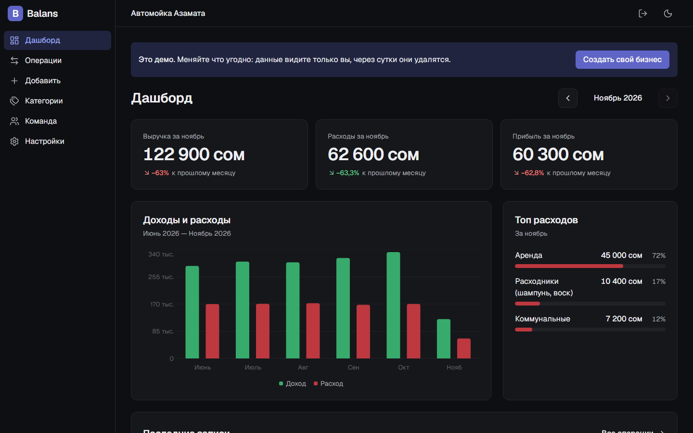
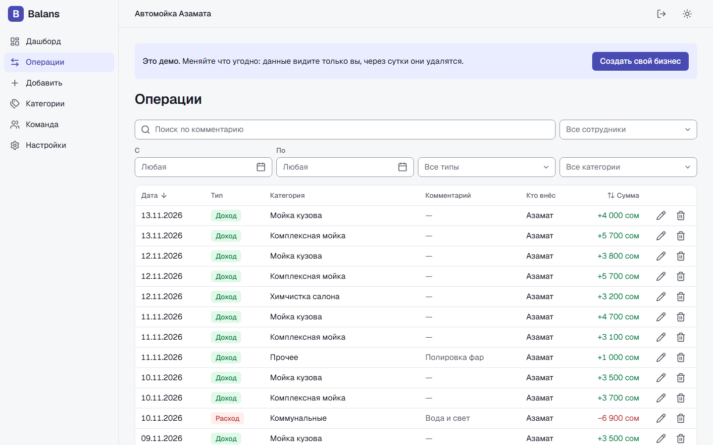

# Balans

Онлайн-тетрадь доходов и расходов для небольшого бизнеса услуг: автомойки, барбершопа, СТО. Администратор вносит записи с телефона за минуту, владелец видит выручку, расходы и прибыль за месяц.

**[Открыть сайт](https://balans-pet.vercel.app)** · на главной кнопка **«Посмотреть демо»**: без регистрации, своя копия «Автомойки Азамата» с данными за полгода.

<table>
  <tr>
    <td width="33%"></td>
    <td width="33%"></td>
    <td width="33%"></td>
  </tr>
</table>

## Что умеет

- **Запись за минуту.** Сумма, категория одной кнопкой, дата уже стоит сегодняшняя. Сумма показывается с пробелами («16 000»), дата выбирается в календаре.
- **Итоги считаются сами.** Выручка, расходы и прибыль за месяц со сравнением с прошлым, график за полгода, топ расходов.
- **Операции.** Таблица на компьютере и карточки на телефоне: поиск по комментарию, фильтры по датам, типу, категории и сотруднику, сортировка, изменение и удаление.
- **Команда.** Владелец приглашает сотрудника ссылкой. Сотрудник вносит записи и видит только свои, итогов и прибыли не видит, свою запись может исправить в течение суток.
- **Категории** доходов и расходов: стартовый набор при создании бизнеса, свои добавляются, ненужные скрываются без потери истории.
- **Ставится на телефон** как приложение (PWA). Без интернета показывает «Нет соединения», а запись, отправленная без сети, уходит сама, когда сеть вернётся.
- **Демо** для тех, кто пришёл посмотреть: анонимный вход и своя копия бизнеса, гости не мешают друг другу, через сутки копия удаляется.
- Светлая и тёмная тема, интерфейс на русском, деньги в сомах, время по Бишкеку.

## Стек

- **Next.js 16** (App Router, Server Actions, Cache Components / Partial Prerendering) + TypeScript
- **Tailwind CSS v4** + **shadcn/ui** на Base UI, своя дизайн-система с токенами светлой и тёмной темы
- **Supabase**: PostgreSQL, Auth (почта + пароль, Google, анонимный вход для демо), Row Level Security, pg_cron
- React Hook Form + Zod, Recharts, react-day-picker
- Хостинг **Vercel**

Отдельного бэкенда нет: серверные действия Next.js и функции в базе.

## Что внутри интересного

- **Права проверяет база, а не интерфейс.** Каждая таблица закрыта Row Level Security: бизнес не видит данных другого, сотрудник не видит чужих записей и итогов, менять свою запись может только 24 часа. Скрытые кнопки в интерфейсе — только для удобства.
- **Целостность в схеме.** Категория записи обязана принадлежать тому же бизнесу и иметь тот же тип (составной внешний ключ). Создание бизнеса и принятие приглашения — транзакционные функции, двойной клик не создаёт дубликатов.
- **Демо без общего аккаунта.** Каждый гость получает свою копию, данные генерируются в базе до сегодняшнего дня, поэтому демо не устаревает. Демо-гость не может пригласить людей или вступить в настоящий бизнес. Очистку делает pg_cron раз в час.
- **Три состояния везде.** У каждого списка и графика есть загрузка (скелетоны), пусто и ошибка с «Повторить». На дашборде каждый блок падает отдельно, остальные работают.
- **Адаптив проверяется автоматически.** Скрипт на Playwright снимает страницы на 6 ширинах (360–1920 px) в обеих темах и проверяет, что нет горизонтальной прокрутки (`npm run check:screens`).

## Документы

- [Техническое задание](docs/TZ.md): роли, страницы, этапы и решения по ходу работы
- [Дизайн-система](docs/DESIGN.md): токены, типографика, состояния и компоненты; живая витрина на странице `/design`
- [Миграции базы](supabase/migrations): схема, права и функции по этапам

Pet-проект Даниэла для портфолио.
