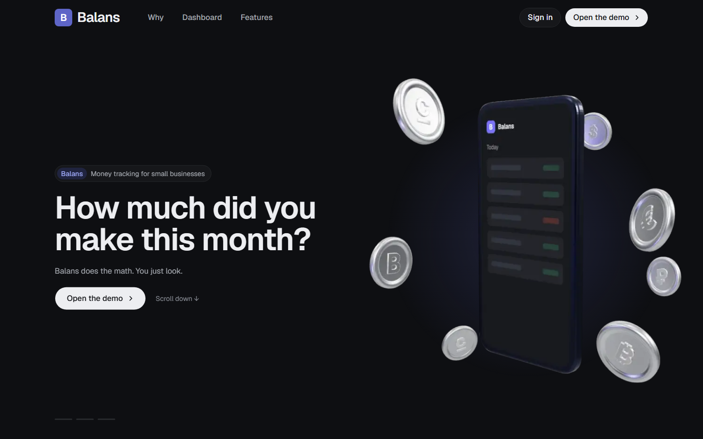
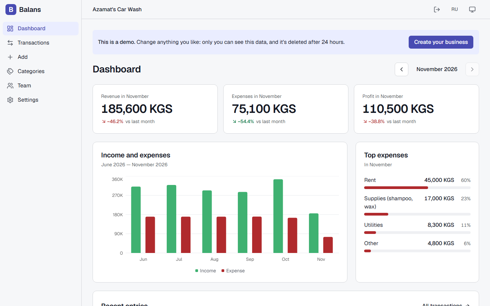
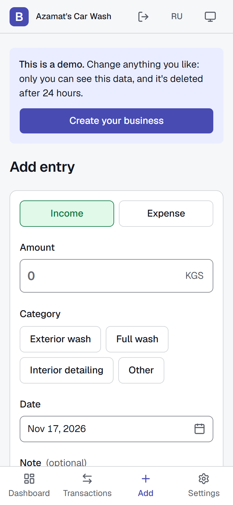
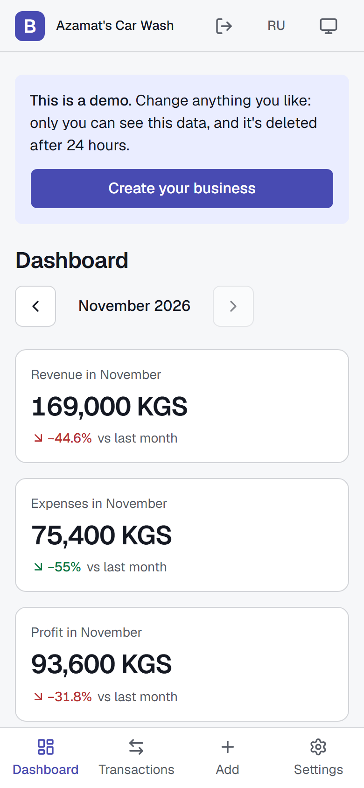
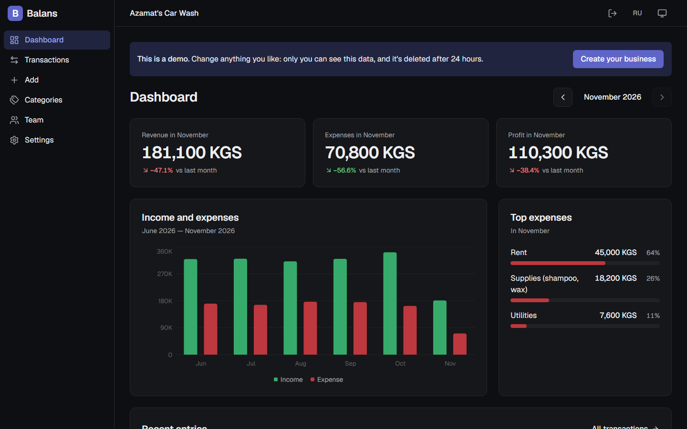
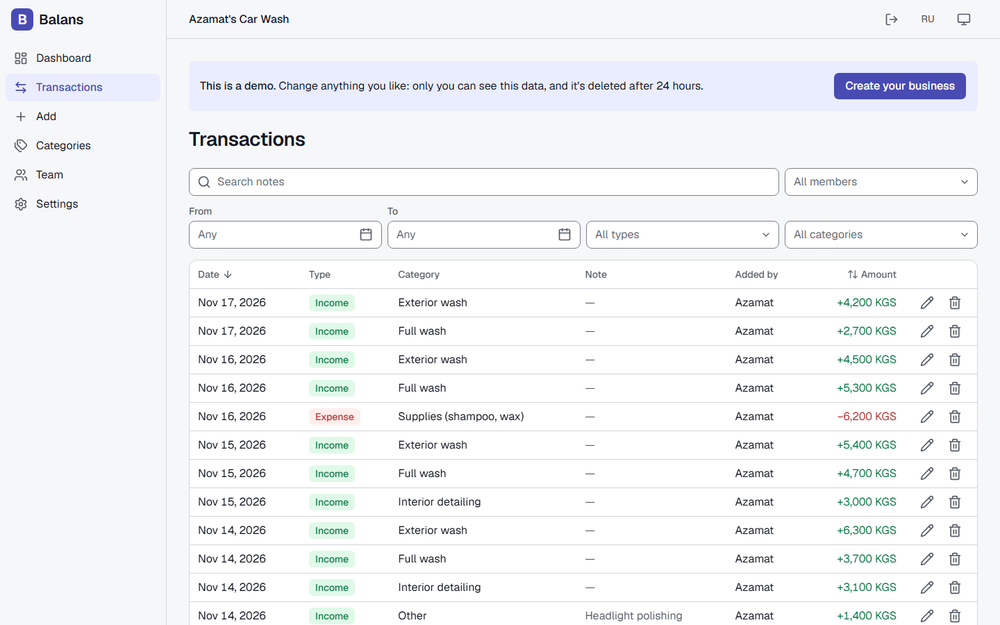

# Balans

An online ledger of income and expenses for small service businesses: car washes, barbershops, auto repair shops. Staff log a sale from a phone in under a minute, and the owner sees revenue, expenses and profit for the month.

**[Live site](https://balans-pet.vercel.app/?lang=en)** · click **Open the demo**: no sign-up, you get your own copy of "Azamat's Car Wash" with six months of data.





<table>
  <tr>
    <td width="33%"></td>
    <td width="33%"></td>
    <td width="33%"></td>
  </tr>
</table>



## What it does

- **An entry in a minute.** Amount, category in one tap, today's date already set.
- **Totals count themselves.** Revenue, expenses and profit for the month compared with the previous one, a six-month chart, top expenses.
- **Transactions.** A table on desktop and cards on a phone: search, filters by date, type, category and team member, sorting, editing and deleting.
- **Team.** The owner invites an employee with a link. An employee adds entries and sees only their own, never totals or profit, and can fix their entry within 24 hours.
- **Installs on a phone** as an app (PWA). Offline it shows "No connection", and an entry sent without a network goes through when it's back.
- **Demo** for visitors: anonymous sign-in and a private copy of the business, guests don't see each other, the copy is deleted after 24 hours.
- English and Russian, light and dark theme in the cabinet, money in Kyrgyz som, time in Bishkek.

## Stack

- **Next.js 16** (App Router, Server Actions, Cache Components / Partial Prerendering), **React 19**, TypeScript
- **Tailwind CSS v4** + **shadcn/ui** on Base UI, with its own design system of tokens
- **Supabase**: PostgreSQL, Auth (email + password, Google, anonymous for the demo), Row Level Security, pg_cron
- **next-intl** for English and Russian, **three.js** + **React Three Fiber** for the 3D hero, Recharts, React Hook Form + Zod
- Hosted on **Vercel**

There is no separate backend: Next.js server actions and functions in the database.

## Roles and security

Access is checked by the database, not by the interface. Every table has Row Level Security policies, so a hidden button is only a convenience:

| Role | Can do |
|---|---|
| Owner | Everything in their business: entries, totals, categories, team, settings |
| Employee | Adds entries and sees only their own; can change an entry for 24 hours; no totals, no profit, no owner pages |
| Demo guest | A private copy of a sample business; can't invite people or join a real business |
| Superadmin | A report on all businesses through database functions; for everyone else the page answers 404 |

- One business never sees another business's data.
- An entry's category must belong to the same business and have the same type (a composite foreign key).
- Creating a business and accepting an invitation are transactional database functions: a double click doesn't create duplicates.
- The superadmin is a row in a table that the site can neither read nor change, not an email check.

## The 3D hero, and why it's fast

The first screen is a phone with the Balans interface and silver coins flying into it as you scroll. The coins are a Blender model (glTF with Draco compression, 42 KB). The phone and its screen are drawn in code: the interface is a `<canvas>` texture that redraws only when the step or a number changes.

- **A picture first.** The first screen is the headline and a WebP poster of the scene (10–22 KB), captured from the scene itself. The largest paint is text or that image, never the canvas.
- **3D only when needed.** The scene code is a separate chunk downloaded only after the first scroll, touch or mouse move. A visitor who only opens the page never downloads it.
- **Nothing drawn off screen.** No frames while the block is out of view or the tab is hidden.
- **It backs off on weak devices.** It watches the frame rate and lowers pixel density, then falls back to pictures that change by step.
- **Pictures instead of 3D right away** with "reduce motion", no WebGL, data saver, low memory, a lost WebGL context, or `NEXT_PUBLIC_HERO_3D=off`.

## Lighthouse

Landing page, mobile, production build (`next start`), November 2026:

| Accessibility | Best Practices | SEO | Performance |
|---|---|---|---|
| 100 | 100 | 100 | 89 |

Performance is the median of 3 runs with real CPU throttling (`--throttling-method=devtools`): LCP 2.2 s, CLS 0. In Lighthouse's default simulated mode the same page scores 67 (LCP 3.7 s). The 3D isn't part of these numbers: it isn't loaded until the visitor interacts.

## Run locally

1. Create a Supabase project. In SQL Editor, run the files from [`supabase/migrations`](supabase/migrations) in order. In Authentication, enable email sign-in and anonymous sign-ins (for the demo); Google is optional.
2. Create `.env.local`:
   ```
   NEXT_PUBLIC_SUPABASE_URL=https://<project>.supabase.co
   NEXT_PUBLIC_SUPABASE_PUBLISHABLE_KEY=<publishable key>
   ```
3. `npm install`, then `npm run dev` and open http://localhost:3000.

`npm run check:screens -- /` takes screenshots of a page at 6 widths (360–1920 px) in both languages and checks there's no horizontal scroll.

## Documents (in Russian)

- [Specification](docs/TZ.md): roles, pages, stages and decisions along the way
- [Design system](docs/DESIGN.md): tokens, type, states and components; live showcase at `/design`
- [Landing](docs/LANDING.md): structure, texts and how the 3D works

---

## По-русски

Balans — онлайн-тетрадь доходов и расходов для небольшого бизнеса услуг. Администратор вносит записи с телефона, владелец видит выручку, расходы и прибыль за месяц. Права проверяет база (Supabase RLS): сотрудник не видит итогов и прибыли, один бизнес не видит данных другого.

[Открыть сайт на русском](https://balans-pet.vercel.app/?lang=ru) · кнопка «Открыть демо» даёт свою копию автомойки с данными за полгода, без регистрации.

Pet-проект Даниэла Кубанычбекова для портфолио.
